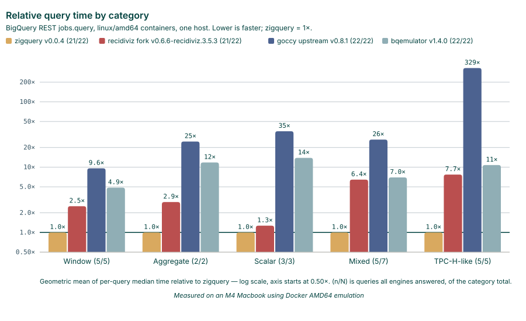

# ⚡️ZigQuery - A BigQuery Emulator

<p style="text-align: center;">
  <strong>A BigQuery emulator server, built on [Zig](https://ziglang.org], [GoogleSQL](https://github.com/google/googlesql), and [SQLite](https://sqlite.org).</strong><br />
  Focused on query engine correctness, performance, throughput, and stability
</p>


<p style="text-align: center;">

<em>Measured on an M4 Macbook using Docker AMD64 emulation</em>
</p>

## Usage
```
docker pull ghcr.io/recidiviz/zigquery:latest
```

```
Usage:
  zigquery-server --project=<name> [OPTIONS]

A local BigQuery emulator serving the REST API and the Storage Read API.

Flags take the form --name=value.

Options:
  --project=<name>        project ID to serve (required)
  --dataset=<name>        create an empty dataset with this ID at startup
  --host=<addr>           address both servers bind (default: 0.0.0.0)
  --port=<port>           REST API port (default: 9050)
  --grpc-port=<port>      Storage Read API gRPC port; 0 picks a free port (default: 9060)
  --database=<path>       SQLite file to store data in; :memory: or empty keeps data in memory (default: :memory:)
  --data-from-json=<path> load datasets and tables from a JSON file at startup; repeatable, files load in order
  --log-level=<level>     accepted for compatibility; currently ignored
  --log-format=<format>   accepted for compatibility; currently ignored
  -h, --help              show this help and exit
```

## Development

[See docs/BUILD.md](./docs/BUILD.md) for environment setup and build commands.


## Why Zig?

[GoogleSQL](https://github.com/google/googlesql)'s query analyzer powers the core of the emulator.
It is written in C++ and requires a complex build system configured in Bazel.
Zig can link C natively, so interop becomes nearly free.

Intentional, explicit control over memory allocation improves process stability.


## The Query Spec Suite

`testdata/specs` holds three trees, each with its own `NOTICE`:

| Tree | Cases | Where its expectations come from |
|---|---:|---|
| `googlesql/`, `bigquery/` | 1012 | goccy/googlesqlite, whose values were scraped from the result tables printed in the GoogleSQL reference docs. Imported by `tools/spec_import.py`; do not hand-edit. |
| `zigquery/` | 748 | This engine's own regression suite, inherited from go-zetasqlite's `query_test.go`. Hand-maintained. |

Every `.zon` file under `testdata/specs` is a spec.
`zigquery/` files declare `.typed = true`, which asserts each expected value's *type* and not only its value;
the imported trees cannot, because a doc table does not say whether `42` was an INT64 or the string `"42"`.
See `src/internal/spec_expect.zig`.

`testdata/spec_baseline.txt` lists the `spec<TAB>desc` of every case that must
keep passing, and `zig build spec` exits nonzero on any regression. Regenerate
it with `zig build spec -- --update-baseline`.

`zig build coverage` and `zig build coverage-spec` measure what the unit tests and the corpus each execute.
[docs/COVERAGE.md](docs/COVERAGE.md) has the current figures and the two caveats worth knowing before quoting one: the runs
cannot be summed, and a line counts as covered once control reaches it.

## CI & releases

| Workflow | Trigger | What it does |
|---|---|---|
| `ci.yml` | PR, push | ephor + `zig fmt`, unit tests, the spec corpus under `--strict`, the concurrency harnesses, and a `gen-proto` drift check |
| `bench.yml` | push, `bench` label, manual | `gsql-bench --json` charted by github-action-benchmark on the `benchmarks` branch |
| `release.yml` | `v*.*.*` tag | four platform tarballs, a multi-arch GHCR image, and a GitHub release |

Runners are powered by [RunsOn](https://runs-on.com) on EC2 (see `.github/runs-on.yml`).
Release builds for darwin run on GitHub-hosted larger runners: arm64 and x64 built and smoke-tested natively rather than cross-compiled.


# Addendum
The architecture comes from our work on the fork of [@goccy](https://github.com/goccy)'s original implementation.
We are very grateful for his contributions to open source software.